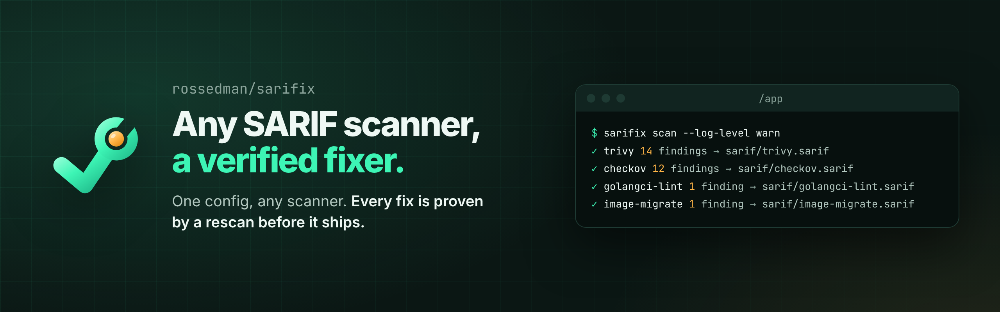

<p align="center"></p>

<p align="center">
  <a href="https://github.com/rossedman/sarifix/actions/workflows/ci.yml"></a>
  <a href="https://github.com/rossedman/sarifix/actions/workflows/ci.yml"></a>
  <a href="https://goreportcard.com/report/github.com/rossedman/sarifix"></a>
  <a href="https://github.com/rossedman/sarifix/releases"></a>
  <a href="LICENSE"></a>
  <a href="https://rossedman.io/sarifix/"></a>
</p>

sarifix turns any SARIF-emitting scanner into an automated fixer. It reads SARIF findings, has an AI agent fix them in small single-rule batches, proves each fix by re-running the scanner and your tests, and publishes the result as a PR, review suggestions or local edits. Trivy, Checkov, golangci-lint and your in-house tools plug in through config, with no code changes.

> **Status: Phase 1 (report and plan).** Loading, validating, normalizing and fingerprinting SARIF works today, as do `config validate`, `scan`, `diff`, `plan`, `fix --mode report` and `fix --mode issues` (one GitHub issue per batch, for Claude or a person to fix). `check` reports what a change introduced and runs as a Claude Code hook. sarifix's own fixing modes (local, pr and review), `doctor` and `stats` land in phases 2 to 5. See the [roadmap](https://rossedman.io/sarifix/roadmap/).

## Install

With Homebrew, on macOS or Linux (releases after v0.2.0):

```sh
brew install rossedman/tap/sarifix
```

With Go:

```sh
go install github.com/rossedman/sarifix/cmd/sarifix@latest
```

Or download a binary from [releases](https://github.com/rossedman/sarifix/releases) and verify it (see [Verifying releases](SECURITY.md#verifying-releases)). Container image: `ghcr.io/rossedman/sarifix`. Release archives and the Homebrew cask include shell completions and a man page.

## Quick start

Describe your scanners in `sarifix.yaml` at the repo root. Each one is an argv list with placeholders, run without a shell:

```yaml
version: 1
scanners:
  - name: trivy
    match: ["Trivy"]
    command: ["trivy", "config", "--format", "sarif", "-o", "{out}", "{dir}"]
  - name: golangci-lint
    command: ["golangci-lint", "run", "--output.sarif.path={out}", "./..."]
rules:
  allow: [trivy/DS-0002, golangci-lint/errcheck]
```

Check it, scan, change some code, scan again, and compare the two scans by fingerprint. Line numbers never count, so here the errcheck finding that moved from line 8 to line 11 is unchanged:

```console
$ sarifix config validate -q
✓ sarifix.yaml
$ sarifix scan --out-dir base --log-level warn
✓ trivy 3 findings → base/trivy.sarif
✓ golangci-lint 1 finding → base/golangci-lint.sarif
$ sarifix scan --log-level warn
✓ trivy 3 findings → sarif/trivy.sarif
✓ golangci-lint 1 finding → sarif/golangci-lint.sarif
$ sarifix diff --base 'base/*.sarif' --head 'sarif/*.sarif' --unchanged
0 new  0 fixed  4 unchanged

Unchanged
  = golangci-lint/errcheck main.go:11 Error return value of `f.Close` is not checked
  = Trivy/DS-0002 Dockerfile:1 Artifact: Dockerfile Type: dockerfile Vulnerability DS-0002 Severity: HIGH Message: Specify at least 1 USER command in D…
  = Trivy/DS-0025 Dockerfile:2 Artifact: Dockerfile Type: dockerfile Vulnerability DS-0025 Severity: HIGH Message: '--no-cache' is missed: apk add curl…
  = Trivy/DS-0026 Dockerfile:1 Artifact: Dockerfile Type: dockerfile Vulnerability DS-0026 Severity: LOW Message: Add HEALTHCHECK instruction in your D…
```

### With Claude Code

Add `sarifix check --hook` as a Claude Code Stop hook, and Claude fixes the findings its own changes introduced before it finishes:

```json
{ "hooks": { "Stop": [ { "hooks": [ { "type": "command", "command": "sarifix check --hook" } ] } ] } }
```

Only findings new since `HEAD` are reported, never the existing backlog. See the [tutorial](https://rossedman.io/sarifix/tutorials/claude-code-hook/).

### In GitHub Actions

One step installs sarifix and your scanners, scans, uploads to code scanning and keeps one GitHub issue per batch, for Claude or a person to fix. On pull requests, the same step reports what the change introduced:

```yaml
permissions:
  contents: read
  security-events: write
  issues: write
steps:
  - uses: actions/checkout@v7
    with: { fetch-depth: 0 }
  - uses: rossedman/sarifix@v0.2.3
```

See the [GitHub Action](https://rossedman.io/sarifix/action/) for modes and inputs, and [Turn findings into issues Claude works through](https://rossedman.io/sarifix/tutorials/claude-queue/) to hand the issues to Claude.

SARIF files are build output: regenerate them on every run and keep them out of git (`sarif/` in `.gitignore`). In CI, upload them to code scanning or keep them as an artifact. See [Where SARIF files live](https://rossedman.io/sarifix/guides/sarif-files/).

Every command takes `--json` for machine output. Exit codes: `0` success, `1` runtime error, `2` config error, `3` some batches failed verification, or `check` found new findings.

[`examples/sarifix.yaml`](examples/sarifix.yaml) shows every key. The [configuration guide](https://rossedman.io/sarifix/configuration/) and the generated [reference](https://rossedman.io/sarifix/reference/config/) cover them in detail.

## Scanners

Any tool that writes SARIF is a scanner. This `sarifix.yaml` runs eight of them, covering infrastructure as code and Terraform hygiene, Go and Python, secrets and Dockerfiles. Keep the ones that fit your repo:

```yaml
version: 1
scanners:
  # Infrastructure as code: Terraform, Kubernetes, Helm, Dockerfiles
  - name: trivy
    match: ["Trivy"]
    command: ["trivy", "config", "--quiet", "--format", "sarif", "-o", "{out}", "{dir}"]
  - name: checkov
    match: ["Checkov"]
    command: ["checkov", "-d", "{dir}", "--quiet", "-o", "sarif", "--output-file-path", "{outdir}"]
    output: "{outdir}/results_sarif.sarif" # Checkov picks its own file name

  # Terraform hygiene: parse errors, unpinned modules, modules that follow a
  # branch. tfmetrics names its SARIF file after the repo, so copy it to {out}.
  - name: tfmetrics
    command:
      - sh
      - -c
      - tfmetrics scan "$1" --out "$2/tfmetrics" --sink sarif > /dev/null && cp "$2"/tfmetrics/sarif/*.sarif "$3"
      - sh
      - "{dir}"
      - "{outdir}"
      - "{out}"

  # Code
  - name: golangci-lint
    command: ["golangci-lint", "run", "--output.sarif.path={out}", "./..."]
    workdir: "{dir}"
  - name: ruff
    command: ["ruff", "check", "--exit-zero", "--output-format", "sarif", "-o", "{out}", "{dir}"]
  - name: semgrep
    match: ["Semgrep OSS", "Semgrep"]
    command: ["semgrep", "scan", "--quiet", "--metrics=off", "--config", "p/default", "--sarif-output={out}", "{dir}"]
    timeout: 10m

  # Secrets
  - name: gitleaks
    command: ["gitleaks", "dir", "{dir}", "--no-banner", "--report-format", "sarif", "--report-path", "{out}", "--exit-code", "0"]

  # A tool that prints SARIF to stdout: run it through sh and redirect.
  - name: hadolint
    command: ["sh", "-c", "hadolint -f sarif Dockerfile > \"$1\"", "sh", "{out}"]
    workdir: "{dir}"
rules:
  min_level: warning
```

`{dir}` is the tree being scanned, `{out}` the SARIF file sarifix reads, and `{outdir}` a scratch directory for the scan. A scanner may exit non-zero when it finds something; only a missing SARIF file counts as a failure. A `match` is needed only when the tool's SARIF `tool.driver.name` differs from `name`.

[tfmetrics](https://github.com/rossedman/tfmetrics) reports Terraform that doesn't parse, remote modules with no version or ref, and git modules that follow a branch. Its outdated-module rule needs version lookups, so it never fires from `scan`. It writes one file per repo, named after the repo, so its entry copies that file to `{out}`. A repo with no Terraform gets no file, and sarifix then reports the scanner as failed, so use the entry only where there's Terraform.

With every scanner above, `sarifix check` reports nine findings on a change that adds a `.env` file, a Dockerfile `apk add`, a Go call that drops its error, a Python `shell=True` call and an unpinned Terraform module. Checkov flags the module too:

```console
$ sarifix check --log-level warn
9 new findings since 906c21e0838e (0 fixed)
  checkov/CKV_TF_1 error main.tf:10
  checkov/CKV_TF_2 error main.tf:10
  gitleaks/aws-access-token warning .env:2
  golangci-lint/errcheck error y.go:6
  hadolint/DL3018 warning Dockerfile:2
  semgrep/generic.secrets.security.detected-aws-access-key-id-value.detected-aws-access-key-id-value error .env:2
  semgrep/python.lang.security.audit.subprocess-shell-true.subprocess-shell-true error b.py:4
  tfmetrics/tfmetrics/unpinned-module warning main.tf:10
  trivy/DS-0025 error Dockerfile:2
```

Each finding also prints its message and help link, left out here. An in-house tool plugs in the same way; see [writing a custom scanner](https://rossedman.io/sarifix/tutorials/custom-scanner/).

## Settings precedence

sarifix's own CLI settings resolve as **flag > `SARIFIX_*` environment variable > settings file** (`$XDG_CONFIG_HOME/sarifix/settings.yaml`, `~/.config/sarifix/settings.yaml` or `~/.sarifix/settings.yaml`, or the file named by `--settings`). For example, `SARIFIX_LOG_LEVEL=debug` or `log-level: debug`. `sarifix.yaml` is separate: it is the repo's fixing policy, chosen with `--config` and optionally layered over an org default with `--org-config`.

## Documentation

The full docs live at **<https://rossedman.io/sarifix/>**: [getting started](https://rossedman.io/sarifix/getting-started/), [tutorials](https://rossedman.io/sarifix/tutorials/) on real repositories, [how fingerprints work](https://rossedman.io/sarifix/guides/fingerprints/), the [security model](https://rossedman.io/sarifix/security/) and the [command reference](https://rossedman.io/sarifix/reference/commands/sarifix/).

## Repository layout

| Path | What's there |
| --- | --- |
| [`cmd/sarifix`](cmd/sarifix), [`internal/`](internal) | The CLI |
| [`pkg/`](pkg) | The pipeline, one package per step ([architecture](https://rossedman.io/sarifix/architecture/)) |
| [`examples/`](examples) | Config, an in-house scanner and a CI workflow to copy from |
| [`docs/`](docs) | The docs site source |
| [`testdata/`](testdata), [`test/integration/`](test/integration) | Fixtures from real scanner runs, and end-to-end tests |
| [`tools/`](tools) | Repo checks and doc generators |

`examples/`, `testdata/`, `test/integration/` and `tools/` each have a README. Go packages document themselves in their package comments (`go doc ./pkg/finding`).

## Contributing

See [CONTRIBUTING.md](CONTRIBUTING.md). `make check` runs everything CI runs. Security reports go through [SECURITY.md](SECURITY.md).

## License

[MIT](LICENSE)
