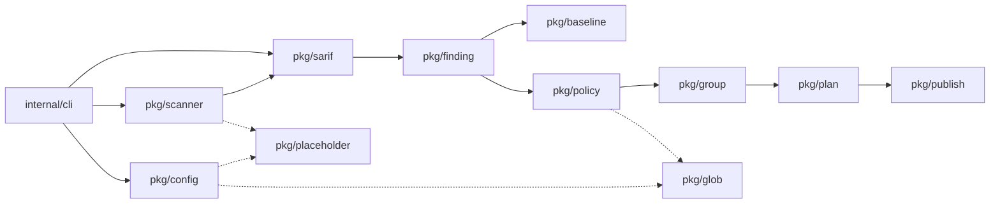

# Architecture

How the code is organized and how a command moves data through it. Read this before changing anything under `pkg/` or `internal/`.

sarifix is one Go binary built from small packages. Each package does one step of the pipeline, and the parts that touch the outside world (scanners today; the agent, the forge and the state store later) sit behind interfaces, so tests can replace them with fakes.

## Packages

Solid arrows follow the data; dotted ones are helper libraries.

| Package | Role | Main entry points |
| --- | --- | --- |
| `cmd/sarifix` | `main`: runs the CLI and maps errors to exit codes | `main` |
| `internal/cli` | Cobra commands, flags, viper settings, human and JSON output. One command per file. | `Execute`, `NewRoot` |
| `internal/ui` | Every terminal style (lipgloss), the fang help theme, the `slog` handler, and `Sanitize` for untrusted text | `NewStyles`, `Sanitize`, `NewLogger` |
| `internal/version` | Build information injected with `-ldflags` | `Get` |
| `internal/github` | A minimal GitHub REST client for issues mode: list, create, edit, comment, label. Implements `publish.Tracker` | `FromEnv` |
| `internal/gitrepo` | The few git commands `check` needs: repo root, git directory, resolving a revision, temporary worktrees | `Root`, `Resolve`, `AddWorktree` |
| `pkg/config` | `sarifix.yaml`: schema, defaults, `--org-config` layering, validation with file:line errors | `LoadLayered`, `(*Loaded).Validate` |
| `pkg/scanner` | Runs a configured scanner as a subprocess (no shell, own process group, timeout) and routes SARIF runs by tool name | `NewExec(...).Scan`, `(*Registry).Route` |
| `pkg/sarif` | Loads SARIF 2.1.0, validates each run against the official schema, normalizes URIs to repo paths, writes runs back from their original JSON plus patches | `LoadGlobs`, `NewNormalizer`, `(*Log).Write` |
| `pkg/finding` | Turns results into `Finding`s: rule keys, levels, anchors, fingerprints | `NewExtractor`, `(*Extractor).Extract`, `Annotate` |
| `pkg/baseline` | Compares two finding sets as a multiset of fingerprints | `Compare` |
| `pkg/policy` | Judges each finding against the rules and gives skipped ones a reason | `New(...).Apply` |
| `pkg/group` | Batches fixable findings per rule or campaign, splits by limits, orders and caps; names branches | `Batches`, `Slug` |
| `pkg/plan` | Runs policy and grouping and records one status per finding | `Build`, `(*Plan).Summarize`, `(*Plan).Annotate` |
| `pkg/publish` | Mode handlers. Today: report mode (enriched SARIF and a JSON summary) and issues mode (one issue per batch, through a `Tracker`) | `Report`, `Issues`, `IssueBody` |
| `pkg/placeholder` | Expands `{out}`, `{outdir}`, `{dir}`, `{paths}` and `{repo}` in argv templates | `ExpandArgs`, `Unknown` |
| `pkg/glob` | Path globs (`**`, segment-bound `*`) and rule-key globs (`*` crosses `/`) | `MatchPath`, `MatchKey` |

`pkg/` packages don't import `internal/`, so the pipeline can be used as a library. `internal/` holds what only the CLI needs.

## What a command does

### `sarifix scan`

1. `internal/cli` loads and validates the config (`config.LoadLayered`, `Validate`).
2. For each scanner, `scanner.Exec.Scan` expands the command's placeholders, runs it in a fresh temporary directory, and loads the SARIF it wrote. A non-zero exit counts as success when SARIF was written, since most scanners exit non-zero when they find something.
3. `finding.Extractor` computes each finding's anchor and fingerprint, and `finding.Annotate` records it as `partialFingerprints["sarifix/v1"]`.
4. `(*sarif.Log).WriteFile` writes `sarif/<scanner>.sarif`: the tool's original JSON for each run, with the fingerprints patched in.

### `sarifix plan` and `sarifix fix --mode report`

1. Load config, then `sarif.LoadGlobs` reads the SARIF. A run that fails schema validation is skipped with a warning; the others load.
2. `finding.Extractor.Extract` produces findings. Paths are normalized by `sarif.Normalizer`, which resolves `uriBaseId` chains, strips the repo root or a CI workspace root, and rejects anything outside the repo.
3. `plan.Build` runs `policy.Apply`, then `group.Batches`, and records a status for every finding: `batched`, `deferred` or `skipped` with a reason.
4. `plan` prints the result. `fix --mode report` calls `publish.Report`, which patches `properties.sarifix` into every finding's SARIF result and writes `summary.json`. `fix --mode issues` passes the batches to `publish.Issues` with an `internal/github` client.

### `sarifix check`

1. Find the git root and load the config from it.
2. Resolve `--base` (default `HEAD`). Look for its scan in `.git/sarifix/scans/<commit>-<config hash>/`; if it isn't there, check the commit out into a temporary worktree (`internal/gitrepo`), scan it, and cache the result.
3. Scan the working tree into a temporary directory.
4. `baseline.Compare` the two, leaving out any scanner that failed on either side. Then `policy.Apply` with `IgnoreAllow`, so `rules.allow` doesn't filter feedback.
5. Print the new findings, or with `--hook`, answer Claude Code in JSON: `additionalContext` for Claude, `systemMessage` for the user. See [ADR 6](adr/0006-feedback-hook.md).

### `sarifix diff`

Loads both sides, extracts findings (base lines are read under `--base-root`), and calls `baseline.Compare`. Line numbers never take part. See [Fingerprints](guides/fingerprints.md).

## Design rules

These are the decisions that shape the code. The [decision records](adr/0001-layout-and-cli-wiring.md) give the reasoning.

- **SARIF is written from its original JSON.** go-sarif's structs serialize zero values that change a log's meaning, such as a rule's `"enabled": false`. Each `SourcedRun` keeps its raw JSON, and changes are recorded as patches (`AddPartialFingerprint`, `SetResultProperty`) and applied when writing. ([ADR 2](adr/0002-dependencies-and-sarif-io.md))
- **Identity never uses line numbers.** Precedence: the tool's `primaryLocationLineHash`, its other partial fingerprints, sarifix's recorded `sarifix/v1`, then a hash of the finding's anchor. ([ADR 3](adr/0003-fingerprints.md))
- **Scanner output is untrusted.** Messages and paths are passed through `ui.Sanitize` before reaching a terminal, and are never logged at info level. URIs that escape the repo produce findings with no location, which are never fixable.
- **Every skip has a reason.** Nothing disappears silently between scan and plan. ([ADR 5](adr/0005-policy-and-batching.md))
- **One command per file**, registered in `init()`. `NewRoot` builds a fresh command tree on every call, so tests never share flag state. ([ADR 1](adr/0001-layout-and-cli-wiring.md))
- **Exit codes are part of the CLI contract:** 0 success, 1 runtime error, 2 config error (any `*config.Errors`), 3 failed batches.

## Where the next phases go

The [spec](roadmap.md) adds these packages, each behind an interface with a fake:

| Package | Phase | Interface |
| --- | --- | --- |
| `pkg/agent` | 2 | `Agent.Fix(ctx, FixTask) (FixResult, error)`, with a Claude Code headless implementation |
| `pkg/sandbox` | 2 | Per-batch git worktree with no network |
| `pkg/verify` | 2 | Diff guard, rescan, target fingerprints gone, no new findings, tests pass |
| `pkg/forge` | 3 | `Forge`: open PRs, find open PRs by branch, post reviews (GitHub first) |
| `pkg/state` | 3 | `Store`: record and query attempts (JSONL, then SQLite) |
| `pkg/metrics` | 5 | Aggregation for `sarifix stats` |

`pkg/publish` gains the `local`, `pr` and `review` handlers, and `fix` stops rejecting those modes.

## Tests

- Unit tests live next to the code. Shared fixtures from real scanner runs are in [`testdata/`](https://github.com/rossedman/sarifix/tree/main/testdata), and the [`testdata/README.md`](https://github.com/rossedman/sarifix/blob/main/testdata/README.md) explains each one and how to regenerate it.
- `internal/cli` tests run commands through `Execute` and compare against golden files in `testdata/plan/`.
- [`test/integration`](https://github.com/rossedman/sarifix/tree/main/test/integration) runs real scanners, behind the `integration` build tag.
- Critical paths have benchmarks and fuzz targets, listed in [Contributing](contributing.md#critical-paths).
