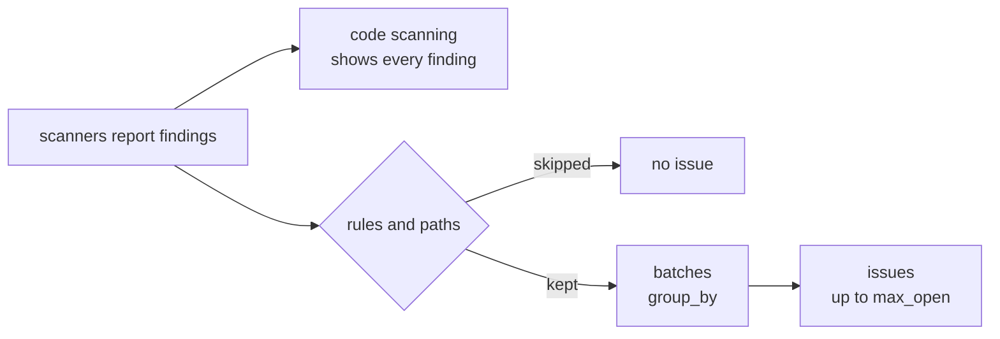

# Configuration

`sarifix.yaml` tells sarifix how to run your scanners and which of their findings to act on. This page starts with a config that works, explains how a finding becomes an issue, and shows how to find out why one didn't. The sections after that cover each part of the file. The [config reference](reference/config.md) lists every field, type and default.

## Start here

One YAML file at the repo root. This one runs Trivy and Semgrep, imports CodeQL's alerts from code scanning, and turns every finding into an issue:

```yaml title="sarifix.yaml"
version: 1

scanners:                 # what to run, and which SARIF tool names it reports as
  - name: trivy
    match: ["Trivy"]
    command: ["trivy", "config", "--quiet", "--format", "sarif", "-o", "{out}", "{dir}"]
    group_by: file        # one issue per file, not per check
  - name: semgrep
    match: ["Semgrep OSS", "Semgrep"]
    command: ["semgrep", "scan", "--quiet", "--metrics=off", "--config", "p/default", "--sarif-output={out}", "{dir}"]
    timeout: 10m
  - name: codeql          # no command: its alerts come from code scanning
    match: ["CodeQL"]

rules:                    # which findings sarifix acts on
  allow: ["trivy/*", "semgrep/*", "codeql/*"]
  min_level: note         # every level; the default, warning, drops notes

paths:
  deny: ["vendor/**", "**/testdata/**"]

publish:
  issues:
    max_open: 20          # issues open at once; the rest wait their turn
    queue: 0              # issues handed to an agent; 0 hands over none
```

Check it with `sarifix config validate`. It applies the defaults and prints the resolved config. Errors name the file, the key and the line, such as `scanners[2].command: must not be empty`. There are 30 checks. Add `--strict` to also reject an `allow` glob that matches no scanner.

## From finding to issue

Every finding your scanners report is uploaded to code scanning, so the Security tab shows all of them. Only some become issues. A finding has to pass each check below, in this order. Then it's grouped into a batch, and each batch is one issue:



| Check | Setting | Default | Skip reason in `plan` |
| --- | --- | --- | --- |
| The SARIF tool name matches a scanner | `scanners[].match` | the scanner's `name` | `unrouted` |
| It points at a file in the repo | | | `no_location` |
| It's not in the baseline (only with `--baseline`) | | | `in_baseline` |
| Its level is at least `min_level` | `rules.min_level` | `warning` | `below_min_level` |
| Its rule isn't denied | `rules.deny` | none | `rule_denied` |
| Its rule is allowed, or in a campaign | `rules.allow` | none, so **nothing is allowed** | `rule_not_allowed` |
| Its file isn't denied | `paths.deny` | `.github/workflows/**` | `path_denied` |

What's left is grouped: one batch per rule, or per file with `group_by` ([Batches](#batches)). Issues mode keeps one issue per batch, the most severe first, up to `publish.issues.max_open`. The rest open as earlier ones close ([Issues](#issues)).

!!! tip "Levels and code scanning's severities"
    sarifix reads each finding's SARIF `level`: `error`, then `warning`, then `note`, then `none`. Code scanning shows the same levels as Error, Warning and Note. For security rules it shows a severity instead (Critical, High, Medium or Low), which comes from the rule, not the level. Trivy's Medium "Restrict container images to trusted registries" is a `warning`. `min_level: note` keeps everything except `none`. `min_level: error` keeps errors only, which can be nothing at all.

## Why isn't a finding an issue?

Run `plan` on the same SARIF with `--details`. It lists every skipped finding under its reason. For example, a repo whose code scanning showed 35 open alerts and no issues:

```console
$ sarifix scan --log-level warn
✓ trivy 21 findings → sarif/trivy.sarif
✓ semgrep 14 findings → sarif/semgrep.sarif
$ sarifix plan --sarif 'sarif/*.sarif' --details
35 findings  0 batched in 0 batches  0 deferred  35 skipped

Skipped
  below_min_level 35
     semgrep/go.lang.security.audit.crypto.math_random.math-random-used internal/postmark/client.go:12 (warning < error)
     …
```

Every finding was a warning or a note under `min_level: error`. Narrow the list to one rule with `--rule 'semgrep/*math*'`. The fix for each reason:

| Reason | What to change |
| --- | --- |
| `unrouted` | Add the tool's SARIF name (`tool.driver.name`, shown in the reason) to a scanner's `match`. |
| `no_location` | Nothing: a finding with no file in the repo can't be fixed by editing code. |
| `below_min_level` | Lower `rules.min_level`. |
| `rule_denied` | Remove the matching glob from `rules.deny`. |
| `rule_not_allowed` | Add a glob for the rule to `rules.allow`, such as `semgrep/*`. |
| `path_denied` | Remove the matching glob from `paths.deny`. `.github/workflows/**` can't be removed. |

`plan` splits the batches into the ones a fixing run would take (`limits.batches_per_run`, default 5) and the rest, which it calls deferred. Issues mode uses all of them, deferred included. If `plan` batches a finding but there's no issue for it, more batches exist than `publish.issues.max_open`. The job summary of the action's run lists every issue it opened, closed or queued. For an [imported scanner](#imported-scanners), check that the run could read code scanning alerts. A warning in the log says when it couldn't.

## What each command uses

| | `scan` | `check` and the Stop hook | `plan`, `fix` and the action's issues mode |
| --- | --- | --- | --- |
| `scanners` | runs them | runs them, before and after the change | reads their SARIF |
| `rules.min_level`, `rules.deny`, `paths.deny` | | yes | yes |
| `rules.allow` | | no: feedback on a change covers every rule that isn't denied. `--allowed-only` applies it | yes |
| `limits.group_by` | | | yes |
| `publish.issues` | | | issues mode |

`rules.allow` is the fixing policy: what sarifix may fix, or hand to an agent, unasked. Your own changes get feedback on everything that isn't denied.

## Scanners

A scanner is any command that writes SARIF. sarifix needs to know three things: what to call it, which SARIF tool names it produces, and how to run it.

| Field | Purpose |
| --- | --- |
| `name` | Unique ID. Used in rule keys such as `trivy/DS-0002` and in branch names. |
| `match` | The `tool.driver.name` values routed to this scanner. Defaults to `[name]`, compared case-insensitively. |
| `command` | The argv to run. There is no shell. Placeholders are expanded in each element. Leave it out for an [imported scanner](#imported-scanners). |
| `output` | Where the SARIF lands, for tools that choose their own file name. Default `{out}`. |
| `workdir` | Working directory. Default `{repo}`. |
| `env` | Extra environment variables. |
| `scope` | Rescan scope during verification: `changed`, `dir` or `repo`. |
| `timeout` | Per invocation. Default 5 minutes. |
| `offline` | Run verification rescans without network. |
| `group_by` | Overrides [`limits.group_by`](#batches) for this scanner's findings. |

A tool that is not a known scanner needs no code. The repo's custom-tool fixture is a 25-line shell script that prints SARIF, wired in with this entry:

```yaml
- name: image-migrate
  command: ["./tools/image-migrate.sh", "{dir}", "{out}"]
  env: { CT_MODE: "ci" }
  scope: changed
```

### Imported scanners

Some tools already report to GitHub code scanning and don't run well from a script, such as CodeQL. A scanner with no `command` is *imported*: sarifix never runs it, and `sarifix scan`, `sarifix check` and the Stop hook skip it. Instead, `sarifix alerts export` reads the repository's open code scanning alerts for it and writes them as SARIF. Plan, batching and issues mode then treat them like any other finding:

```yaml
scanners:
  - name: codeql
    match: [CodeQL]   # the alerts' tool name
rules:
  allow: ["codeql/*"]
```

```console
$ sarifix alerts export
✓ codeql 4 open alerts → sarif/code-scanning.sarif
$ sarifix plan --sarif 'sarif/*.sarif'
```

The [GitHub Action](action.md) runs the export itself in issues mode, so adding the entry is the whole setup. Alerts from tools that no imported scanner matches are left out, since sarifix's own scan already covers the scanners it runs. Issues for imported findings can't list a rescan to prove the fix, so their **Done when** points at the pull request's code scanning results. Reading alerts needs a token with `security-events` read. See [ADR 9](adr/0009-imported-scanners.md).

### Placeholders

Placeholders are expanded in `command`, `output`, `workdir` and `env` values. Any other brace is literal text, so JSON arguments pass through unchanged. An unknown placeholder is a config error.

| Placeholder | Expands to |
| --- | --- |
| `{out}` | The SARIF file sarifix expects the tool to write. |
| `{outdir}` | The directory for that file, for tools that take a directory. |
| `{dir}` | The directory to scan. |
| `{paths}` | The files to scan. A whole argv element equal to `{paths}` becomes one element per path; inside a larger element the paths are joined with spaces. |
| `{repo}` | The repository root. |

Checkov takes an output directory and picks its own file name, so it sets `output` as well:

```yaml
- name: checkov
  match: ["Checkov"]
  command: ["checkov", "-d", "{dir}", "-o", "sarif", "--output-file-path", "{outdir}"]
  output: "{outdir}/results_sarif.sarif"
```

## Rules and paths

`rules.allow` and `rules.deny` are globs over the key `<scanner>/<ruleId>`, such as `checkov/CKV_AWS_20`. `paths.deny` is a list of globs over repo-relative paths. The two kinds of glob behave differently, on purpose.

| | Rule keys (`rules.*`) | Paths (`paths.deny`) |
| --- | --- | --- |
| `*` | Matches any run of characters, **including `/`**, because rule IDs can contain slashes. | Stays inside one path segment. |
| `?` | One character. | One character within a segment. |
| `**` | Not special. | A whole path segment matching zero or more segments. `**/*_generated.go` is valid; `a**b` is an error. |
| Example | `checkov/CKV_AWS_*` | `vendor/**` |

```yaml
rules:
  allow:
    - trivy/DS-0002
    - checkov/CKV_AWS_*
    - image-migrate/*
  deny: ["*/secrets-*"]
paths:
  deny: [".github/workflows/**", "vendor/**", "**/*_generated.go"]
```

!!! warning "Workflows are always denied"
    `.github/workflows/**` is denied however you configure `paths.deny`, including when you replace the list. Fixing tools that edit CI are a way to escalate privileges, so this is not optional. The planned diff guard enforces it on the actual diff, not only in the prompt. See [Security](security.md).

## Batches

sarifix fixes findings in batches: one branch and one pull request, or one issue in [issues mode](guides/modes.md#issues). A campaign is always one batch. Other findings are grouped by `limits.group_by`:

| `group_by` | One batch per | Suits |
| --- | --- | --- |
| `rule` (default) | Rule, such as `semgrep/missing-ssl-minversion` across seven files | Rules spread across the code |
| `file` | Scanner and file, with every rule it reports there | Scanners that check one file for many settings, such as Trivy on Kubernetes manifests |
| `auto` | Rule, except that rules a scanner reports in only one file share a batch for that file | A mix of both |

For example, on a repository where Trivy flags eight settings in one manifest and Semgrep reports three rules across several Go files, `rule` makes 11 batches and `auto` makes 4: the eight Trivy rules become one batch, `trivy:examples/kubernetes/app.yaml`. Batches stay within one scanner. `limits.files_per_batch` and `limits.findings_per_batch` split any batch that is too big.

```yaml
limits:
  group_by: auto
```

A scanner can override it. When Trivy flags the same checks in several Kubernetes manifests, `auto` merges nothing, because each rule is in more than one file. Grouping only Trivy by file gives one batch per manifest and leaves the other scanners' rules alone:

```yaml
scanners:
  - name: trivy
    match: [Trivy]
    command: ["trivy", "config", "--quiet", "--format", "sarif", "-o", "{out}", "{dir}"]
    group_by: file
```

Changing `group_by` changes batch IDs, so issues mode closes the old issues and opens the regrouped ones. See [ADR 8](adr/0008-group-by.md).

## Issues

`sarifix fix --mode issues`, and the GitHub Action on pushes and schedules, keep one GitHub issue per batch. The settings live under `publish.issues`:

| Setting | Default | What it does |
| --- | --- | --- |
| `label` | `sarifix` | Put on every issue sarifix opens. sarifix never touches an issue without it. |
| `max_open` | `10` | How many issues are open at once, the most severe batches first. When one closes, the next batch gets an issue. Raise it to see the whole backlog at once. |
| `queue` | `0` | How many issues to keep labeled `queue_label`, which hands them to an agent queue. Above 0, this starts paid agent runs. The action's `queue` input overrides it. |
| `queue_label` | `agent-ready` | The label that hands an issue to an agent. |

An issue closes when the next scan no longer reports its batch. That only happens if its scanner's SARIF was read in that run, so a scanner that fails doesn't make its issues look fixed. [Turn findings into issues Claude works through](tutorials/claude-queue.md) covers the agent side.

## Layering with an org config

Pass `--org-config` to put an org-wide default file under the repo's file:

```bash
sarifix config validate --org-config org/sarifix.yaml --config sarifix.yaml
```

The repo file is applied on top of the org file:

- **Scalars and lists replace.** If the repo sets `rules.allow`, the org's `rules.allow` is gone, not appended to.
- **`scanners` merge by `name`** and **`campaigns` merge by `id`.** A repo entry with the same name as an org entry replaces it whole; other org entries are kept.

For example, with an org file that defines `trivy` and `checkov`, and a repo file that redefines `trivy` and adds `golangci-lint`, the resolved config has three scanners: the repo's `trivy`, the org's `checkov` and the repo's `golangci-lint`. The resolved output of `config validate` shows which result you get, and error messages point at the file where the offending entry was defined.

## Reference

Every field, its type and its default are in the [config reference](reference/config.md), generated from the same schema the validator uses. The command flags are in the [command reference](reference/commands/sarifix.md).
